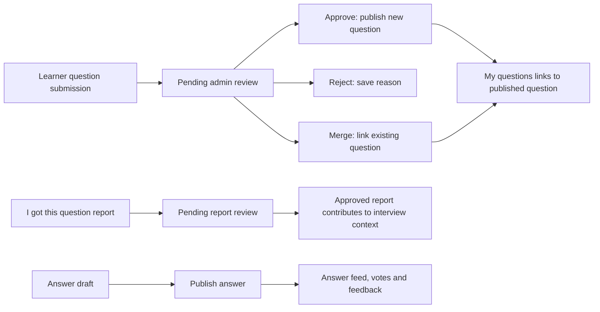

# Interview Questions: Developer Handoff and Change Analysis

Reviewed: 14 October 2026, Asia/Calcutta.

## 1. Scope and source revisions

This document describes the interview-question functionality and UI across the learner website, admin panel, and TPS backend. It is based on Git history and the source currently present in the shared workspace, rather than on proposed designs or earlier chat messages.

“From commit” is interpreted inclusively: the supplied commit introduces the main feature set, and subsequent commits contain corrections and visual changes. The comparison is therefore `<starting-commit>^..HEAD`. Changes after the supplied commit are also identified separately.

| Repository | Inclusive starting commit | Reviewed HEAD | Working-tree status when reviewed |
| --- | --- | --- | --- |
| `product-space-next-ui` | `351907ae07a107c43c92e1038e20797634c80923` | `d822f807426c581c1026bc90db23413e25886526` | Clean |
| `product-space-admin` | `f3a08437b5e383acec3fbf5cc8d44f6c4549fd19` | `f3a08437b5e383acec3fbf5cc8d44f6c4549fd19` | One whitespace-only modification in `InterviewSubmissions.tsx`; no behavioral difference from HEAD |
| `tps-monorepo` | `c25f14849e3f34ff941e6567aba3f5b3a1e52e21` | `53f11eb0d1ccbdfa2aaf78c3fc9c71759b76bb02` | Clean before this document was created |

The ranges also contain certificate-related work and merge commits. Certificate fonts, certificate generation, S3 changes, and the dashboard certificate page are outside this handoff.

### Relevant commit sequence

| Repository / commit | Contribution |
| --- | --- |
| Backend `c25f148` — “modify the interview question page” | Reports, answer drafts, expert/pinned flags, learner submissions, moderation APIs, context aggregation, and schema additions |
| Admin `f3a0843` — “modify the interview-question page” | Submission and report review screens; expert/pin controls and report overview on question details |
| Learner UI `351907a` — “modify the interview question page” | Submission form and My questions, report modal, draft-enabled answer editor, answer filters, and revised listing/detail components |
| Backend `53f11eb` — “new change for that interview question page in the tps” | Correct report insertion during approval, transactional publication, transaction support in review updates, and merge lookup by slug or public ID |
| Learner UI `e545fbda` — “fix the ui of the intervew-question page” | Reference styling, fonts, light skeletons, dropdown alignment/scrolling/positioning, company union and logo fallbacks, feedback state correction, and card-wide navigation |
| Learner UI `d822f807` — “remove the three dots and instead of save used the bookmark icon” | Bookmark icon on question cards and removal of the unused answer overflow action |

## 2. Product behavior at a glance

The feature separates three different operations:

1. **Ask a new question:** create a private learner submission for admin review. It does not immediately create a public library question.
2. **Report an existing question:** record that a learner encountered a library question at a company, for a role and approximate timing. Only approved reports contribute to public interview context.
3. **Answer an existing question:** publish an answer directly; the editor supports a separate saved draft before publication.

Existing bookmarking, answers, helpful votes, feedback, question administration, and slug/metadata editing remain part of the feature. Their presentation or response handling has changed in places; they were not all introduced by this range.



### Current availability

| Capability | Current state |
| --- | --- |
| All questions / My questions / Saved | Active learner listing tabs |
| Unanswered listing tab | JSX is commented out; the active tab type has no `unanswered` value, and the reviewed backend list handler has no unanswered filter |
| Admin Approve / Merge / Reject | Visible for pending submissions. Merge was temporarily hidden during development but is visible in the reviewed source |
| Custom `InterviewNavigation` | Component and CSS exist, but no component imports/mounts it. The shared navbar remains in use |
| Public server-rendered question body | Not implemented in the reviewed source; content is fetched by client components |
| Notification delivery | The preference is stored and displayed. No delivery workflow is implemented in the reviewed interview code |

## 3. Learner website: listing and question cards

Route: `/interviewprep/interview-questions`.

Primary files under `product-space-next-ui`:

- `src/components/Pages/Interview/InterviewQuestions/InterviewQuestions.tsx`
- `src/components/Pages/Interview/InterviewQuestions/Questions/QuestionList/QuestionsList.tsx`
- `src/components/Pages/Interview/InterviewQuestions/Questions/QuestionList/QuestionCard.tsx`
- `src/components/Pages/Interview/InterviewQuestions/Questions/QuestionList/Sidebar.tsx`
- `src/components/Pages/Interview/InterviewQuestions/Questions/QuestionList/SubmissionCard.tsx`

### Listing controls and loading

- White page with an interview preparation introduction and “Get help with a question” action.
- Search is debounced by **300 ms**. The backend searches the question title and its original `company` field; the placeholder is broader than the actual search implementation.
- Company and role selectors plus a multi-select category dropdown. Category filtering is an OR match using PostgreSQL array overlap.
- Sort values are `recent`, `discussed`, and `reported`.
- The displayed result count uses `meta.total`, with compatibility fallbacks, rather than the number of currently loaded cards.
- Questions load in batches of **10**, with intersection-observer infinite scrolling and `meta.hasNextPage` determining whether to request another batch.
- Filter changes reset fetching to page 1. Clear filters resets search, company, role, selected categories, and sorting.
- Sidebar category actions select a single canonical category value and return to All questions.
- My questions and Saved require sign-in through the existing auth dialog. Public title/card navigation no longer prompts sign-in in `QuestionCard` itself.

### Card behavior

- Title, category tags, company badges, role, interview timing, answer count, and expert availability are shown.
- Clicking card whitespace, tags, or metadata navigates to the detail route. Buttons, links, inputs, selectors, textareas, and elements with `role="button"` are excluded from this handler.
- The title and answer actions remain actual Next.js links; navigation is not implemented solely as a JavaScript click handler.
- “Save” text is replaced with a **bookmark icon**. Saved cards use a filled icon, `aria-pressed`, an accessible label, and a tooltip. Signed-out users are prompted to sign in before bookmarking.
- The expert indicator is shown when an answer has `isExpert`, belongs to legacy author ID `2857`, or has the author name `Product Space`.
- “Share your answer” appears for unanswered cards and links to the detail page’s `#write-answer` anchor.

## 4. Learner question submission and My questions

`AskQuestionModal.tsx` collects:

| Field | Behavior |
| --- | --- |
| Question title | Required; minimum 12 trimmed characters; sent to the moderation endpoint |
| Context | Optional explanation of where the learner is stuck |
| Categories | Multiple selections; “Not sure” clears other selections and is mutually exclusive |
| Role | Optional dropdown with an Other/custom-role field; submission falls back to Product Manager |
| Interview checkbox | Reveals company and approximate interview timing |
| Notify on answer | Stored preference; initially unchecked in this form |

The form prompts for login before submitting if the learner is not authenticated. Successful submission displays a confirmation/reference and provides a route into My questions. The submit label still says “Preview submission,” but the action calls the real API and stores a submission; it is not merely a local preview.

### Duplicate suggestions

- A **350 ms** debounce starts suggestions for titles of at least four characters.
- Backend suggestions require at least three characters and return at most five published matches.
- Matching is case-insensitive substring matching against question title or original company, ordered by answer count and creation date. It is not semantic duplicate detection.

### Dropdown corrections

- Checkbox options use the scoped `ps-check` row styling so checkbox and text remain aligned.
- Category and role triggers align text left and the chevron right.
- Menus have their own scroll containers with `data-lenis-prevent` and overscroll containment.
- Menu placement measures the trigger, modal panel, and viewport. Menus open upward when space below is insufficient and space above is greater; total menu height is capped at 264 px.
- The option scroller uses `min-h-0`, preventing the flex layout from clipping the final option. The last category “Not sure” and last role “Other” remain reachable.
- Outside clicks and Escape close the corresponding dropdown. The modal locks body scrolling while open.

### Submission cards

My questions reads `/interview/questions/my-submissions?userId=...`. Cards show the submitted title/context, categories, role, optional interview details, date, notification indicator, and status:

| Stored status | Learner presentation |
| --- | --- |
| `pending` | Under Review |
| `approved` | Approved & Published |
| `rejected` | Not Accepted, with rejection feedback when present |
| `merged` | Merged with existing |

Approved/merged submissions contain a `canonicalQuestion` with its public `_id`, title, and slug. The title and bottom action link to that question. The learner follows a link; there is no automatic browser redirect when an admin merges the submission.

## 5. Learner detail page, companies, and answers

Route: `/interviewprep/interview-questions/questions/[slug]`.

### Layout and visual system

- Back link, question heading/share action, category chips, compact interview context, answer actions/feed, and a related-question sidebar.
- Context has separate one-company and multiple-company presentations. The latter includes a disclosure with the full company/role breakdown.
- The detail sidebar focuses on related questions rather than the older additional sidebar content.
- The active related-question handler returns up to four other published questions, matching categories or roles first and filling remaining slots with recent published questions. The controller contains an older handler assignment earlier in the file; the later assignment is the effective implementation.
- Reference styling is scoped under `#ps-library` and `#ps-rework` using `interview-listing.css` and `interview-detail.css`.
- Shared typography is Manrope with local regular, medium, semibold, and bold TTF assets and `font-display: swap`.
- Layouts use a 1280 px maximum width and responsive padding. Desktop sidebars use 350 px, increasing to 400 px at the largest breakpoint; smaller layouts stack columns.
- Loading skeletons use white cards, pale placeholders, and subtle borders. The detail loading branch now supplies a full-width white background so gaps do not inherit the parent’s black background.

### Company sources and logo fallback

`questionCompanies.ts` combines the original `question.company` with `interviewContext.companies`:

1. Add the trimmed original company first, except `General`.
2. Add reported companies and deduplicate by a lowercase, trimmed name.
3. Merge role values for a company that appears in both sources.
4. Preserve actual report metadata from the interview context when it exists.

Both cards and detail pages use this combined list. Displayed company counts can therefore be greater than backend `interviewContext.totalCompanies`, which counts reported companies only when actual reports exist.

An original company that has no matching context report receives zero report records in the frontend helper and is labelled “Original question company · Interview timing unavailable” in the breakdown. Adding it to the display does not insert a database report or increase the accepted-report total.

`CompanyBadge.tsx` tries a known local company logo first, then a Simple Icons CDN slug when supplied. If neither is available, or the image fails to load, it displays the company name. Single-company and breakdown rows can keep the name visible alongside a valid logo.

### Answers, voting, feedback, and drafts

- Answer tabs are All answers, Expert, and Community, each with a count.
- Expert classification includes the legacy Product Space author checks described above.
- Sort modes are Most helpful and Newest. Pinned answers always sort before unpinned answers; helpful sorting uses likes count and creation date as a tiebreaker.
- Cards display author information, expert/featured indicators, rich content, read-more controls, helpful voting, and feedback.
- Helpful voting uses an optimistic local update with rollback on failure.
- The unused three-dot action is removed. An author-owned answer still has the delete action and confirmation.
- Posting feedback prevents the form’s default navigation and blocks a repeated submission while a request is in progress.
- **Feedback response correction:** the API returns an updated answer, not a question. The card replaces local feedback with the server’s saved list, and the detail page replaces only the matching entry in `question.answers`. Title, categories, company context, and sibling answers are retained.

The answer editor uses Tiptap StarterKit, level-3 headings, and a placeholder. Its toolbar includes bold, italic, heading, paragraph, bullet/numbered lists, undo, and redo. It restores an existing draft for the question/user, autosaves after **1500 ms**, supports manual Save draft, and publishes through the answer endpoint. Successful answer publication returns a full question and deletes the user’s saved draft in the backend.

The `#write-answer` link opens the inline editor when the detail component mounts. Sharing copies the current URL and displays success only after clipboard writing succeeds.

### “I got this question” reports

`ReportQuestionModal.tsx` collects company, role, and approximate timing, requires a signed-in user, and sends a pending report. Its confirmation does not immediately change public interview context: admin acceptance is required, and the learner page must fetch updated data afterward.

## 6. Admin panel

Both admin and superadmin have route wrappers for the same shared components:

| Route suffix | Purpose |
| --- | --- |
| `/interview-questions/submissions` | Learner Question Submissions moderation |
| `/interview-questions/reports` | Firsthand interview-report moderation |

Prefixes are `/admin` and `/superadmin`. The main interview-question admin screen adds navigation into these queues.

### Submission review

`InterviewSubmissions.tsx` provides refresh, paginated results (initial limit 20), status filters for All/Pending/Approved/Rejected/Merged, a detail view, and actions for pending rows.

- **Approve:** opens a dialog with editable title, company, and role. Confirm & Publish creates a public question, and an approved report when the submission contains interview details. The UI does not currently expose category editing, although the API accepts it.
- **Reject:** collects a reason; the backend uses a default reason if none is supplied. The submission remains in the review records and the reason appears to the learner.
- **Merge:** asks for an existing question’s public ID or slug and links the submission to that question. It does not create another question, copy submission context into the question, or add an interview report.

The placeholder also suggests numeric IDs. The reviewed backend resolves `public_id` or slug, not the internal numeric PostgreSQL ID. The UI wording should be kept consistent with that contract.

### Report review

`InterviewReports.tsx` lists reported question, learner, company, role, timing, status, and date. It supports status filtering, pagination (initial limit 20), refresh, approval/rejection, and editing reported company/role before acceptance. Timing is displayed but is not editable through the current edit dialog or update endpoint payload.

Only reports with `status = 'approved'` are included when questions are hydrated for public context. Editing a company recalculates its logo slug in the repository.

### Admin question details

`QuestionInformation.tsx` adds:

- Interview Context & Reports overview with accepted reports, companies, timing, and company-role breakdown.
- Expert and pinned answer badges.
- Helpful-vote counts.
- Mark Expert / remove Expert and Pin / unpin controls. The page refetches the question after a successful flag update.

## 7. Backend API contracts

Routes below include the `/interview` prefix mounted by `tps-backend/server.js`. IDs in question/answer/report/submission route parameters are public `_id` values unless explicitly noted.

| Method and path | Input / behavior | Response shape |
| --- | --- | --- |
| `GET /interview/user/questions` | `page`, `limit`, `userId`, `onlySaved`, `view`, `company`, `role`, `type`, `search`, `sort` | `{ success, meta, data }` |
| `GET /interview/questions/slug/:slug` | Optional `userId` for saved state | Full question with answers, context, and `isSaved` |
| `GET /interview/questions/:slug/with-related` | Related-question lookup | Related question list |
| `POST /interview/questions/submit` | Learner submission fields | `201 { success, message, submission }` |
| `GET /interview/questions/my-submissions` | `userId` | Submission array with canonical-question links |
| `GET /interview/questions/suggest-duplicates` | `q` or `query` | Array of up to five matching published questions |
| `GET /interview/admin/question-submissions` | `page`, `limit`, `status` | `{ submissions, total, page, limit, totalPages }` |
| `PUT /interview/admin/question-submissions/:id/review` | `action: approve/reject/merge`, review fields | Review result; approval also contains a full `question` |
| `POST /interview/questions/:questionId/reports` | `userId`, optional `userName`, required `companyName`, `roleName`, `interviewTiming`, optional `companyLogo` | `201 { message, report }` |
| `GET /interview/admin/interview-reports` | `page`, `limit`, optional `status`, `questionId` | `{ total, page, limit, reports }` |
| `PUT /interview/admin/interview-reports/:id` | `status`, `companyName`, `roleName`, `reviewedBy` | `{ message, report }` |
| `GET /interview/questions/:questionId/draft` | `userId` | Draft object or `{ content: "" }` |
| `PUT /interview/questions/:questionId/draft` | `userId`, `content` | `{ message, draft }` |
| `PUT /interview/questions/:questionId/answers/:answerId/expert` | `isExpert` | `{ message, answer }` |
| `PUT /interview/questions/:questionId/answers/:answerId/pin` | `isPinned` | `{ message, answer }` |
| `POST /interview/questions/:questionId/answers` | Answer and author fields | Full updated question; also deletes saved draft |
| `POST /interview/questions/:questionId/answers/:answerId/feedback` | Feedback and author fields | Updated answer with its full feedback array |
| `POST /interview/questions/:questionId/answers/:answerId/like` | `userId` | Array of user IDs who liked the answer |
| `POST /interview/questions/:questionId/save` | `userId` | Save/unsave message and `isSaved` |

The existing admin CRUD, answer editing/deletion, feedback editing/deletion, slug availability, slug updates, and metadata routes remain registered. The new service methods live in learner `src/services/interview/interview-service.ts` and admin `src/services/interview-questions/interview-question-service.tsx`.

### List semantics

- Public lists select published questions only.
- Company filter matches original `q.company`; it does not match every company in approved reports.
- Role filter matches `q.roles`, not all roles from reports.
- Categories use overlap against `q.types` and accept arrays/comma-separated values.
- Recent sorts by question creation; discussed sorts by answer count; reported sorts by approved-report count.
- `view=mine` returns submissions, not ordinary question cards. The learner UI normally uses the dedicated My submissions endpoint instead.

### Example review payloads

```json
{
  "action": "approve",
  "title": "What does a Product Engineer do?",
  "company": "Flipkart",
  "role": "Product Manager"
}
```

```json
{
  "action": "merge",
  "canonicalQuestionId": "what-does-a-product-engineer-do"
}
```

`canonicalQuestionId` retains its legacy field name even when its value is a slug. The handler trims input, tries public-ID lookup, then slug lookup, and stores the resolved internal question ID. A missing target returns `404 Canonical question not found`; a blank reference returns 400.

### Transactional approval correction

The original implementation called `insertReport(newQ.id, { ... })`, although the repository expects `insertReport(data, transaction)`. This caused `data.companyName.trim()` to receive an undefined value after the question had already been inserted.

The corrected flow is:

1. Derive a unique slug and approval values.
2. Start a Sequelize transaction.
3. Insert the published question using that transaction.
4. When interview details exist, call `insertReport({ questionId: newQ.id, ... }, transaction)`.
5. Mark the submission approved and store its canonical question ID in the same transaction.
6. Hydrate the new question through that transaction; commit on success or roll back on failure.

`updateSubmissionReview` now accepts an optional third transaction argument; reject/merge callers can still call it without one. Approval uses the edited company for the question, but the automatically inserted report uses the submission’s original company. This distinction is present in the current code.

## 8. Database and serialization

Schema additions are in:

- [20261013180000-create-interview-reports-and-drafts.js](tps-backend/migrations/20261013180000-create-interview-reports-and-drafts.js)
- [20261013190000-create-learner-question-submissions.js](tps-backend/migrations/20261013190000-create-learner-question-submissions.js)
- [mongo-to-pg.schema.sql](tps-backend/scripts/mongo-to-pg.schema.sql)

| Object | New storage and constraints |
| --- | --- |
| `interview_reports` | Public ID, question FK, author, company/logo, role, timing, pending/approved/rejected status, review timestamps/reviewer; index on question and status |
| `interview_answer_drafts` | Question FK, user ID, HTML content, update timestamp; unique `(question_id, user_id)` with upsert |
| `learner_question_submissions` | Public ID, author/contact fields, title/context/categories/role, optional interview details, notification preference, moderation status/reason, canonical question FK, review audit fields; user/status indexes |
| `interview_answers` | `is_expert`, `is_pinned`, and `status` columns |

Report and draft question FKs use cascade deletion. Submission canonical-question FKs use `ON DELETE SET NULL`. Repository serialization preserves the existing Mongo-style `_id`, camelCase fields, nested answers/feedback, and likes arrays while storing relational rows in PostgreSQL.

`hydrate()` loads answers, feedback, and approved reports and produces `interviewContext`. Context groups company names, collects roles/report counts, and derives last-asked labels from approximate timing buckets. It is not calculating elapsed time from an interview date.

If no approved reports exist but the question has a company, the backend emits a legacy fallback context with one report/one company and `isFallback: true`. This is synthetic legacy attribution, not evidence of an accepted learner report.

The repository also contains lazy `ensureSchema()` DDL. Migrations honor `DB_SCHEMA` (default `tps`), while lazy DDL hardcodes `tps`. Use the normal migration process and verify schema configuration rather than relying on runtime DDL as deployment proof.

## 9. Current limitations and follow-up work

These are observations about the reviewed implementation, not completed features:

1. **Access enforcement:** `interviewRoutes.js` registers handlers directly and `server.js` mounts it without an interview-specific auth/admin middleware. Several handlers trust request-supplied user IDs. UI login gates and bearer headers do not establish server-side ownership. The reviewed tree does not contain the proposed `interviewAccess.js` implementation.
2. **Repeat approval:** transactional rollback is implemented, but approval is not guarded against an already-reviewed submission and does not lock that submission row. Repeated/concurrent approvals still need an idempotency design.
3. **Earlier partial writes:** questions inserted before the approval bug was fixed are not automatically cleaned up by the transaction change.
4. **Merge scope:** merge links the submission only; it does not transfer company reports, context, categories, or notification handling. Internal numeric IDs are not a supported merge lookup despite the dialog placeholder.
5. **Notifications:** `notifyOnAnswer` is a stored preference, not a verified email-delivery mechanism in this feature.
6. **Company normalization:** backend report aggregation groups exact trimmed names; the learner helper deduplicates case-insensitively. Public display and backend totals can differ for differently cased names and original-company attribution.
7. **Filters versus badges:** badges include reported companies/roles, but list filters/search operate on original question columns. Selecting a reported company does not necessarily return that question.
8. **No live synchronization:** report acceptance and moderation changes become visible after refetch/refresh; no realtime subscription is added.
9. **Draft lifecycle:** pending autosave timers are not explicitly cancelled on publish/unmount. Verify that draft clearing/restoration cannot race with queued saves before extending this workflow.
10. **Rendered HTML:** answer bodies use `dangerouslySetInnerHTML`; this change set does not establish an HTML-sanitization policy. Read-more truncation slices HTML strings and may cut markup.
11. **Answer status:** the new status column defaults to published, but the reviewed hydration query loads all answer rows without a status predicate. A separate moderated-answer publication workflow is not implemented.
12. **Unused navigation:** the custom white navigation files are present but not mounted; they should not be described as the active site header.

### SEO and performance boundary

This range does not change learner route metadata, canonical URLs, sitemap generation, or robots settings. Title links remain crawlable anchors after card-wide navigation was added. The question heading and content are still fetched client-side; there is no new server-side public-question fetch service in the reviewed tree. The sitemap includes the listing but not individual question URLs, and results use infinite scrolling without crawlable page links. These are existing architectural gaps, not fixes delivered by this change set.

The four new Manrope files total 380,056 bytes before transfer compression. Their production effect on loading, layout shifts, or search performance has not been established by a production benchmark. Font compression/WOFF2 and server-rendering improvements remain separate work.

## 10. Rollout and verification

### Deployment dependencies

1. Apply both schema migrations through the established backend migration process and confirm the target schema/search path.
2. Deploy backend support before or alongside the admin and learner clients that call the new endpoints.
3. Include all four font assets, scoped stylesheets, `CompanyBadge`, and `questionCompanies` in the learner deployment.
4. Confirm client API base URLs target the intended backend; all endpoint paths in this document are relative to that base.
5. Review the access-enforcement and repeat-approval limitations before treating private submissions/drafts and moderation as production-secure workflows.

### Developer acceptance checklist

| Scenario | Expected outcome |
| --- | --- |
| Browse anonymously | Listing and question links work; save/write/report/submit actions require the intended sign-in checks |
| Search/filter/sort | Server parameters match controls; count reflects all results, and infinite scrolling preserves filters |
| Bookmark | Icon toggles without opening the card; saved state is reflected when listing/refetching |
| Submit a question | Private pending submission is created; it is absent from the public list |
| Category/role menus on a short viewport | Inline checkboxes, isolated scrolling, and reachable Not sure/Other options |
| Approve an interview submission | One question, one approved report, and one approved submission update commit together |
| Force report/review failure during approval | No question/report/review mutation commits from that transaction |
| Merge by public ID and by slug | Existing question is linked; no new question or report is created |
| Reject | Reason persists and appears in the learner’s My questions card |
| Approve/edit/reject an interview report | Only accepted reports contribute after the question is refetched |
| Company is Meta but reports contain other companies | Original Meta remains visible; duplicates are removed; failed logos show names |
| Save/reopen an answer draft | Saved HTML restores for the same question/user |
| Publish an answer | Full updated question is returned and saved draft is deleted |
| Post feedback | Only the matching answer changes; heading, context, categories, and other answers stay visible |
| Feedback request fails | Text remains available to retry and submitting state resets |
| Toggle expert/pin in admin | Learner badges/tabs and pinned sorting reflect updated flags after refetch |
| Initial detail load | Full loading surface remains white |

The earlier development session exercised dropdown visibility and company fallback in a hidden browser with sample responses, and exercised approval/rollback, merge lookup, company union, and feedback-state behavior with mocks. This document was checked against the current source and commit ranges. Those checks are not a substitute for live database integration tests or a production SEO/performance audit.

## 11. File ownership map

| Area | Files to start with |
| --- | --- |
| Backend routing | `tps-backend/routes/interviewRoutes.js`, `tps-backend/server.js` |
| Request validation, submission review, publication | `tps-backend/controllers/interviewController.js` |
| Database operations, context aggregation, serialization | `tps-backend/service/interview/interviewRepo.js` |
| Learner listing and card navigation/bookmarks | `product-space-next-ui/src/components/Pages/Interview/InterviewQuestions/Questions/QuestionList/` |
| Learner submissions | `AskQuestionModal.tsx`, `QuestionList/SubmissionCard.tsx` under the learner Questions directory |
| Learner detail/context/report form | `InterviewQuestionDetail/InterviewQuestionDetail.tsx`, `InterviewQuestionDetail/ReportQuestionModal.tsx`, `Questions/CompanyBadge.tsx`, `Questions/questionCompanies.ts` |
| Learner answers/drafts/feedback | `Questions/AnswerForm.tsx`, `Questions/AnswersList.tsx`, `Questions/AnswerCard.tsx` |
| Learner API contracts | `product-space-next-ui/src/services/interview/interview-service.ts` |
| Learner styles and loading | `Interview/interview-*.css`, `Common/Loading/InterviewQuestionSkeleton.tsx`, `src/styles/rich-content.css`, `public/fonts/google/Manrope-*.ttf` |
| Admin review screens | `product-space-admin/src/components/Pages/Common/InterviewQuestions/InterviewSubmissions/InterviewSubmissions.tsx`, `InterviewReports/InterviewReports.tsx` |
| Admin question flags/context | `product-space-admin/src/components/Pages/Common/InterviewQuestions/QuestionInformation/QuestionInformation.tsx` |
| Admin API contracts | `product-space-admin/src/services/interview-questions/interview-question-service.tsx` |

For later comparisons, use each full revision in section 1 and the corresponding repository. Keep UI availability, backend capability, and proposed follow-up work separate when updating this handoff.
